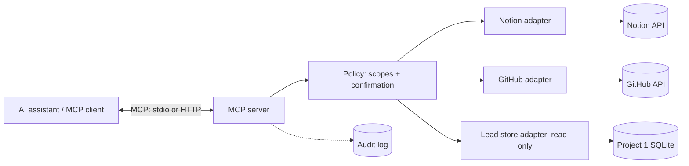

# Plan: Agent portfolio project 2, MCP server for internal tools

- **Value:** high
- **Priority:** P2
- **Slug:** agent-portfolio-mcp-internal-tools
- **Preferred models:** mid, reasoner, coding-agent
- **Assignee:** Daniel
- **Depends on:** agent-portfolio-lead-research-agent

## Progress
- [ ] Step 1: Server skeleton with one hello tool over stdio
- [ ] Step 2: GitHub read tools with fine-grained token
- [ ] Step 3: Notion read tools
- [ ] Step 4: Lead store read tool
- [ ] Step 5: Policy layer, scopes file, audit log
- [ ] Step 6: Confirmed Notion write tool
- [ ] Step 7: Remote transport, auth, container
- [ ] Step 8: Docs, demo recording, write-up draft
- [ ] Done when holds

## Goal
A Model Context Protocol (MCP) server connects an AI assistant to Carefree's internal tools: the Notion task list, GitHub repositories, and the lead data produced by project 1. Access is scoped and read-mostly.

**Hiring signal:** integrating an AI assistant with existing systems safely, which is most of what deployed AI work looks like: authentication, least-privilege scopes, clear tool contracts, audit logs, and handling of untrusted content returned by tools.

Build order: project **2 of 3** (index: `agent-portfolio-index`), started after project 1.

## Context read
- `.plans/README.md`, `.anchor/templates/plan.md`, `GROK.md`, `CLAUDE.md`
- `agent-portfolio-index` (build order and shared ground rules)
- Original standalone HTML draft of this plan (converted here to markdown)

## Depends on (detail)
- `agent-portfolio-lead-research-agent`: the lead store adapter reads project 1's SQLite lead store, so its schema must exist first.

## MVP scope
- MCP server exposing a small, well-described tool set:
  - Notion: list and read tasks, filter by status or due date.
  - GitHub: list repos, read files, list open issues and pull requests.
  - Leads: query the project 1 lead store (read only).
  - One narrow write: add a comment or create a task in Notion, behind an explicit confirmation step.
- Per-tool scopes configured in one file; tools not listed are not exposed.
- Audit log of every tool call (who, what, arguments, result size, time).
- Works with at least one MCP-capable client over stdio, and a remote transport for the demo.

## Non-goals
- No deletes, merges, pushes, or permission changes.
- No access to email, payments, or customer communications.
- No multi-tenant hosting; this is a single-organization server.

## Architecture sketch



Each adapter uses its own least-privilege credential (for example a fine-grained GitHub token limited to chosen repositories with read access, and a Notion integration shared only with the task database). The policy layer checks scope before any adapter runs and requires confirmation for the single write tool.

## Suggested stack
- **Language:** Python with the official MCP Python SDK (TypeScript SDK is an equal option).
- **APIs:** Notion API, GitHub REST API.
- **Config:** a single YAML or TOML file for enabled tools and scopes.
- **Secrets:** environment variables or a local secret manager; never committed.
- **Client for testing:** any MCP-capable assistant, plus the MCP Inspector, with a local open-weight model where the client supports it.
- **Deploy:** container on a small VPS or a serverless platform that supports remote MCP.

## Constraints
- Built in a new public repository under `carefreeinv`, not in this site repo.
- Read-only by default; the single write tool requires explicit confirmation.
- Secrets are never committed. The demo uses a demo Notion workspace and public repositories only.
- No numbers are published until measured.

## Conventions
Python with the official MCP SDK; one thin adapter per external system behind a shared policy layer. SOLID and the "Code quality defaults" in `.anchor/ANCHOR.md` apply.

## Steps
Milestones sized for weekday evenings, about two hours each.

| # | Task | Touches | Verify by | Route to |
|---|------|---------|-----------|----------|
| 1 | Evening 1: server skeleton with one hello tool over stdio | new public repo (project 2) | Visible and callable from MCP Inspector | human (Daniel) |
| 2 | Evenings 2–3: GitHub read tools with fine-grained token | GitHub adapter | List repos, read file, list issues and PRs | human (Daniel) |
| 3 | Evenings 4–5: Notion read tools | Notion adapter | Query tasks by status and due date | human (Daniel) |
| 4 | Evening 6: lead store read tool | lead store adapter | Query project 1 leads read only | human (Daniel) |
| 5 | Evening 7: policy layer, scopes file, audit log | policy, config, audit log | Disabled tools are not listed; every call logged | human (Daniel) |
| 6 | Evening 8: confirmed Notion write tool | Notion adapter, policy | Write refused without confirmation; tested | human (Daniel) |
| 7 | Evenings 9–10: remote transport, auth, container | transport, Dockerfile | Demo instance reachable with auth | human (Daniel) |
| 8 | Evening 11: docs, demo recording, write-up draft | README, write-up | Public repo and write-up ready | human (Daniel) |

## Public deploy and demo plan
- Public repository with setup steps and an example scopes file.
- Demo instance pointed at a demo Notion workspace and public repositories only, so no private data is exposed.
- Screen recording: an assistant answering "what is due this week and which open PRs relate to it" through the server, with the audit log shown alongside.

## Evaluation plan
- **Tool selection accuracy:** a fixed set of questions with the expected tool calls; check whether the assistant picks the right tools and arguments.
- **Answer correctness:** compare answers against ground truth from the demo workspace.
- **Scope enforcement:** tests that out-of-scope tools are not exposed and that writes without confirmation are refused.
- **Latency and cost:** per-call latency from the audit log; token use where the client exposes it.
- These cases feed the project 3 harness.

## Risks
- **Prompt injection through tool results** (issue text, README content, Notion pages): results are returned as data, writes need confirmation, and project 3 adds detection.
- **Over-broad credentials:** mitigated by fine-grained tokens, read-only defaults, and a scopes file reviewed in each PR.
- **MCP spec and SDK changes:** pin versions and keep adapters thin.
- **Exposing a remote server:** require authentication, rate limit, and keep the demo on demo data only.

## Escalation triggers
- Ambiguous requirement discovered → back to planner
- Task fails verification twice → bigger model
- Architectural decision needed → bigger model / human
- Step looks overqualified for its assigned tier → downgrade

## Done when
- A public repository for project 2 exists under `carefreeinv` with setup steps and an example scopes file
- Tests pass showing out-of-scope tools are not exposed and the Notion write is refused without confirmation
- Every tool call appears in the audit log
- The demo instance is reachable only with authentication and points at demo data only
- Demo recording and write-up draft exist, citing only measured numbers

## What broke (template, fill in after shipping)
Left blank on purpose. Each entry is written after a real failure, with links to the commit, issue, or eval run that shows it.

```markdown
### Incident: <short title>
Date found:
Milestone / version:
What I expected:
What actually happened:
How I noticed (eval run, log, user report, manual review):
Root cause:
Fix (link to commit / PR):
Guardrail or test added so it cannot silently return:
Cost of the failure (time, tokens, dollars), measured not estimated:
What I would do differently:
```
