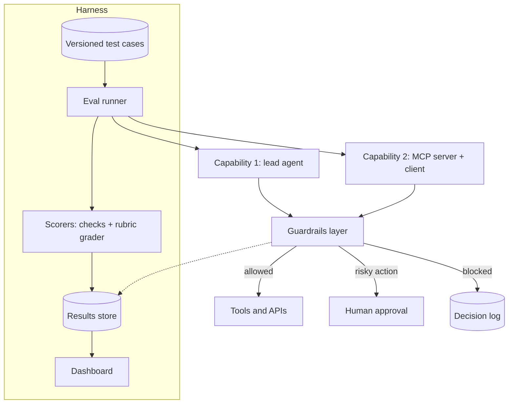

# Plan: Carefree Innovation capability 3, eval dashboard plus guardrails layer

- **Value:** high
- **Priority:** P3
- **Slug:** ci-agent-capabilities-eval-guardrails
- **Preferred models:** mid, reasoner, coding-agent
- **Assignee:** human
- **Depends on:** ci-agent-capabilities-lead-research-agent, ci-agent-capabilities-mcp-internal-tools

## Progress
- [ ] Step 1: Case format and runner; import cases from capabilities 1 and 2
- [ ] Step 2: Scorers and human-check sample
- [ ] Step 3: Cost and latency capture from traces
- [ ] Step 4: Deny-by-default action policy and approval hook
- [ ] Step 5: Injection screening and adversarial test cases
- [ ] Step 6: Dashboard comparing runs
- [ ] Step 7: CI integration for capabilities 1 and 2
- [ ] Step 8: Public dashboard, write-up draft
- [ ] Done when holds

## Goal
Carefree Innovation will build an evaluation harness and dashboard that score the capability 1 and capability 2 agents on accuracy, cost, and latency, and a guardrails layer that wraps both and blocks prompt injection and risky actions (sends, deletes, spending).

**Business value:** a quality and safety layer Carefree Innovation can offer with every AI install, and uses on its own agents first, so each install ships with tests, measured cost and latency, and deny-by-default controls on risky actions.

**What it demonstrates to clients:** agents treated as production software: regression tests for model behavior, measured trade-offs between models, and safety controls that are tested rather than assumed.

Build order: capability **3 of 3** (index: `ci-agent-capabilities-index`), started after capability 2.

## Context read
- `.plans/README.md`, `.anchor/templates/plan.md`, `GROK.md`, `CLAUDE.md`
- `ci-agent-capabilities-index` (build order and shared ground rules)
- Original standalone HTML draft of this plan (converted here to markdown)

## Depends on (detail)
- `ci-agent-capabilities-lead-research-agent`: supplies the first test cases, traces, and the agent the guardrails wrap.
- `ci-agent-capabilities-mcp-internal-tools`: supplies tool-selection and scope cases, and the second system the guardrails wrap.

## MVP scope
- **Harness:** versioned test cases (inputs, expected outputs or rubrics) for capabilities 1 and 2; runs a chosen agent and model configuration and records results.
- **Scorers:** exact-match and schema checks where possible; rubric-based model grading where needed, with a human-checked sample to validate the grader.
- **Metrics per run:** accuracy by case type, tokens and dollars, p50 and p95 latency, guardrail blocks.
- **Dashboard:** compare runs side by side (model A vs model B, before vs after a prompt change).
- **Guardrails layer:** sits between agents and their tools:
  - Action policy: sends, deletes, and spending are denied by default; allowed only with explicit human approval.
  - Prompt-injection screening on untrusted inputs (fetched web pages, tool results) with heuristic rules plus a classifier.
  - Output checks: required fields, no secrets or personal data leaking into drafts.
  - Every decision logged with a reason.
- CI job that runs a small eval subset on every pull request to capabilities 1 and 2.

## Non-goals
- Not a general-purpose eval platform or a hosted multi-tenant product; it is offered as part of Carefree AI installs.
- No claim of complete injection protection; the goal is measured reduction plus deny-by-default actions.
- No large public benchmark runs in the MVP.

## Architecture sketch



## Suggested stack
- **Language:** Python.
- **Harness:** pytest-style runner, or an open-source eval tool such as promptfoo or Inspect if it fits.
- **Grader model:** a local open-weight model by default, with a hosted model as a comparison point.
- **Injection screening:** rules plus an open classifier (for example an open prompt-injection detection model), wrapped behind one interface so it can be swapped.
- **Storage:** SQLite or DuckDB for results.
- **Dashboard:** a static site generated from results (fits GitHub Pages) or Streamlit for local use.
- **CI:** GitHub Actions.

## Constraints
- Built in a new public repository under `carefreeinv`, not in this site repo.
- Sends, deletes, and spending are deny-by-default and need human approval.
- Eval runs use demo data; the dashboard publishes measured results only.

## Conventions
Python; one interface per scorer and per screening method so each can be swapped. SOLID and the "Code quality defaults" in `.anchor/ANCHOR.md` apply.

## Steps
Milestones sized for weekday evenings, about two hours each.

| # | Task | Touches | Verify by | Route to |
|---|------|---------|-----------|----------|
| 1 | Evenings 1–2: case format and runner; import cases from capabilities 1 and 2 | new public repo (capability 3) | One command runs all cases and stores results | human |
| 2 | Evenings 3–4: scorers (schema, exact-match, rubric grader); human-check sample | scorers | Grader agreement with reviewer labels recorded | human |
| 3 | Evening 5: cost and latency capture from traces | metrics | Per-run tokens, dollars, p50 and p95 latency | human |
| 4 | Evenings 6–7: guardrails, deny-by-default action policy and approval hook | guardrails layer | Send, delete, and spend calls blocked without approval; tested | human |
| 5 | Evenings 8–9: injection screening on untrusted inputs; adversarial test cases | guardrails layer, cases | Block and miss rates measured on the test set | human |
| 6 | Evening 10: dashboard comparing runs | dashboard | Two configurations shown side by side | human |
| 7 | Evening 11: CI integration for capabilities 1 and 2 | GitHub Actions in capabilities 1 and 2 | PRs show an eval summary | human |
| 8 | Evening 12: public dashboard, write-up draft | dashboard, write-up | Published with measured results only | human |

## Public deploy and demo plan
- Public repository with the harness, case format, and guardrails layer.
- Static dashboard published on GitHub Pages from real eval runs on demo data.
- Demo recording: an injected instruction hidden in a fetched page, shown being flagged; a send attempt shown being blocked pending approval.
- Write-up comparing at least two model configurations, using only measured numbers.

## Evaluation plan
- **Grader validity:** agreement between the model grader and human labels on a sample.
- **Guardrail effectiveness:** on a labeled adversarial set, the share of injection attempts caught, and the false-positive rate on benign inputs.
- **Action policy:** tests proving that every send, delete, and spend path requires approval.
- **Overhead:** latency and cost added by the guardrails layer.
- **Regression:** eval subset runs in CI; a drop below a chosen threshold fails the build.

## Risks
- **Grader bias or drift:** keep a human-checked sample and pin grader versions.
- **Overfitting to the test set:** hold out cases and add new ones from real failures logged in "What broke".
- **False sense of security:** report misses openly; deny-by-default actions remain the main control.
- **Guardrail overhead:** measure it and allow cheaper checks on low-risk paths.
- **Scope:** resist building a platform; stay focused on capabilities 1 and 2.

## Escalation triggers
- Ambiguous requirement discovered → back to planner
- Task fails verification twice → bigger model
- Architectural decision needed → bigger model / human
- Step looks overqualified for its assigned tier → downgrade

## Done when
- A public repository for capability 3 exists under `carefreeinv` with the harness, case format, and guardrails layer
- One command runs all cases for capabilities 1 and 2 and stores results, including tokens, dollars, and p50/p95 latency
- Tests prove every send, delete, and spend path requires human approval
- Injection block and miss rates are measured on a labeled adversarial set
- CI on capabilities 1 and 2 posts an eval summary on pull requests
- The static dashboard and write-up are published with measured results only

## What broke (template, fill in after shipping)
Left blank on purpose. Each entry is written after a real failure, with links to the commit, issue, or eval run that shows it.

```markdown
### Incident: <short title>
Date found:
Milestone / version:
What we expected:
What actually happened:
How it was noticed (eval run, log, user report, manual review):
Root cause:
Fix (link to commit / PR):
Guardrail or test added so it cannot silently return:
Cost of the failure (time, tokens, dollars), measured not estimated:
What we would do differently:
```
