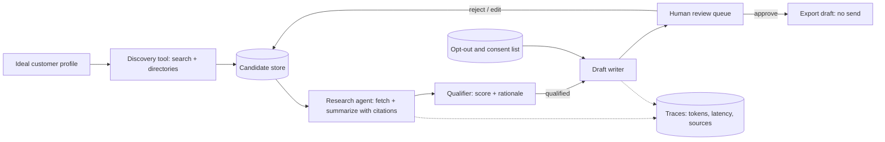

# Plan: Carefree Innovation capability 1, sales / lead research agent

- **Value:** high
- **Priority:** P1
- **Slug:** ci-agent-capabilities-lead-research-agent
- **Preferred models:** mid, reasoner, coding-agent
- **Assignee:** human
- **Depends on:** none

## Progress
- [ ] Step 1: Repo skeleton, schemas, SQLite tables, README
- [ ] Step 2: Discovery tool with robots.txt-aware fetcher
- [ ] Step 3: Research step with citations
- [ ] Step 4: Qualifier with written rationale
- [ ] Step 5: Draft writer with CAN-SPAM checklist and opt-out check
- [ ] Step 6: Review queue UI
- [ ] Step 7: Tracing, cost and latency logging
- [ ] Step 8: Public repo cleanup, demo data, write-up draft
- [ ] Done when holds

## Goal
Carefree Innovation will build an agent that finds qualified small-business leads for its private AI installs and automation services, researches each one, and drafts personalized outreach for a human to review. It never sends anything on its own.

**Business value:** supports Carefree Investments LLC's own sales pipeline as a reusable internal tool, so Carefree Innovation runs the same kind of agent it installs for clients.

**What it demonstrates to clients:** an agent doing real business work end to end, with tool use, structured outputs, source citations, a human-in-the-loop approval step, and compliance constraints designed in from the start. It can be shown as a demo and adapted into a lead research offering for client businesses.

Build order: capability **1 of 3** (index: `ci-agent-capabilities-index`). First public repo targeted around **Tue Nov 24, 2026**.

## Context read
- `.plans/README.md`, `.anchor/templates/plan.md`, `GROK.md`, `CLAUDE.md`
- `ci-agent-capabilities-index` (build order and shared ground rules)
- Original standalone HTML draft of this plan (converted here to markdown)

## MVP scope
- Input: a short ideal-customer profile (industry, region, size range, signals such as "handles sensitive client data").
- Discovery: find candidate businesses from public sources (search results, business directories, company websites).
- Research: for each candidate, collect a short brief (what they do, likely pain points a private AI install could address, contact channel listed publicly), with every claim linked to its source URL.
- Qualification: score each lead against the profile with a short written rationale.
- Drafting: write a personalized email draft per qualified lead.
- Review queue: a simple UI where a human approves, edits, or rejects each draft. Approved drafts are exported (copy or file), not sent.
- Compliance record: per lead, store source of contact info, consent status, and opt-out status.

## Non-goals
- No automatic sending of email, SMS, calls, or social messages. Ever.
- No SMS or phone outreach at all in the MVP (TCPA requires prior express consent for automated calls and texts; the simplest compliant design is to not do them).
- No scraping behind logins, no buying lists, no personal (non-business) contact data.
- No CRM integration in the MVP.

### Compliance notes (CAN-SPAM and TCPA)
- Every email draft includes accurate sender identity, a truthful subject line, the business's physical postal address, and a working opt-out instruction.
- An opt-out list is checked before any draft is created; opted-out businesses are never drafted again.
- Calls and texts are out of scope; if ever added, they require documented prior express consent first.
- This is an engineering plan, not legal advice; the rules will be re-checked against current FTC and FCC guidance before any real outreach.

## Architecture sketch



A single orchestrator runs the steps as a small state machine (discover, research, qualify, draft, review) rather than a free-form autonomous loop, so each step can be tested and retried on its own. Every tool call and model call is traced for capability 3.

## Suggested stack
- **Language:** Python.
- **Models:** a local open-weight model (for example via Ollama or vLLM) for summarizing and drafting; an OpenAI-compatible interface so a hosted model can be swapped in for comparison.
- **Orchestration:** plain Python with typed step functions, or a light framework such as LangGraph or PydanticAI if it earns its place.
- **Structured output:** Pydantic schemas for lead, brief, score, and draft.
- **Search and fetch:** a pluggable search provider (for example SearXNG self-hosted, or a paid search API) plus an HTTP fetcher that respects robots.txt.
- **Storage:** SQLite.
- **Review UI:** a minimal web page (FastAPI with server-rendered HTML, or Streamlit).
- **Tracing:** OpenTelemetry-style spans written to SQLite or an open-source tracer such as Langfuse.

## Constraints
- Built in a new public repository under `carefreeinv`, not in this site repo.
- No send path exists in the code. Export only.
- Demos use public or synthetic data; no private lead or client data is published.
- No numbers are published until measured.

## Conventions
Python with typed step functions and Pydantic schemas; one module per pipeline step so each is testable alone. SOLID and the "Code quality defaults" in `.anchor/ANCHOR.md` apply.

## Steps
Milestones sized for weekday evenings, about two hours each.

| # | Task | Touches | Verify by | Route to |
|---|------|---------|-----------|----------|
| 1 | Evening 1: repo skeleton, schemas, SQLite tables, README with scope and non-goals | new public repo (capability 1) | Tests run in CI on an empty pipeline | human |
| 2 | Evenings 2–3: discovery tool with one search provider and robots.txt-aware fetcher | discovery module | Returns candidates for a sample profile, stored with source URLs | human |
| 3 | Evenings 4–5: research step with citations | research module | Each brief claim links to a fetched page; uncited claims are dropped | human |
| 4 | Evening 6: qualifier with written rationale | qualifier module | Scores and rationales stored; small hand-labeled set to check against | human |
| 5 | Evenings 7–8: draft writer with CAN-SPAM checklist and opt-out check | drafting module | Drafts fail validation if required elements are missing | human |
| 6 | Evenings 9–10: review queue UI (approve, edit, reject, export) | review UI | Full loop runs locally on synthetic or public demo data | human |
| 7 | Evening 11: tracing, cost and latency logging | tracing | Each run produces a trace file | human |
| 8 | Evenings 12–13: public repo cleanup, demo data, short write-up draft | repo, demo data, write-up | First public repo around **Tue Nov 24, 2026** (target) | human |

## Public deploy and demo plan
- Public GitHub repository under [carefreeinv](https://github.com/carefreeinv) with setup instructions and a sample profile.
- Hosted demo runs in a read-only mode against a fixed, public or synthetic dataset; the export button produces a file, and no send path exists in the code.
- A short screen recording of one full run, from profile to approved draft.
- A write-up on carefreeinv.com covering design choices and the "What broke" log (written after the capability ships, per the `.plans/README.md` docs rule).

## Evaluation plan
- **Research accuracy:** on a small hand-checked set of businesses, check what share of brief claims are supported by the cited page.
- **Qualification agreement:** compare agent scores with labels from a Carefree Innovation reviewer on the same set.
- **Draft quality:** rubric (personalization, factual accuracy, tone, compliance elements present), scored by a Carefree Innovation reviewer and optionally by a model grader that is itself spot-checked.
- **Compliance checks:** automated tests that every draft has the required elements and that opted-out businesses never get drafts.
- **Cost and latency:** tokens, dollars (if a hosted model is used), and wall-clock per lead, from traces.
- All of the above become the first test suite for capability 3. No numbers are published until measured.

## Risks
- **Hallucinated facts in outreach:** mitigated by citation-required briefs and human review.
- **Compliance mistakes:** mitigated by no send path, no calls or texts, opt-out checks, and draft validation.
- **Prompt injection from fetched web pages:** fetched text is treated as data; the agent has no tools that act externally. Capability 3 adds explicit detection.
- **Site terms and rate limits:** respect robots.txt and terms; cache fetches; prefer official APIs.
- **Scope creep:** CRM sync, sequences, and auto-follow-ups are explicitly out of scope.
- **Local model quality:** may be weaker than hosted models for drafting; the swap-in interface allows a measured comparison.

## Escalation triggers
- Ambiguous requirement discovered → back to planner
- Task fails verification twice → bigger model
- Architectural decision needed → bigger model / human
- Step looks overqualified for its assigned tier → downgrade

## Done when
- A public repository for capability 1 exists under `carefreeinv` with setup instructions, a sample profile, and README scope and non-goals
- CI runs the test suite, including the compliance tests (required draft elements present; opted-out businesses never drafted)
- The full loop (discover, research, qualify, draft, review, export) runs on synthetic or public demo data
- `grep` of the codebase finds no email/SMS/call send path; approved drafts are exported only
- Each run produces a trace file with tokens and latency
- Demo recording and write-up draft exist, citing only measured numbers

## What broke (template, fill in after shipping)
Left blank on purpose. Each entry is written after a real failure, with links to the commit, issue, or eval run that shows it.

```markdown
### Incident: <short title>
Date found:
Milestone / version:
What we expected:
What actually happened:
How it was noticed (eval run, log, user report, manual review):
Root cause:
Fix (link to commit / PR):
Guardrail or test added so it cannot silently return:
Cost of the failure (time, tokens, dollars), measured not estimated:
What we would do differently:
```
